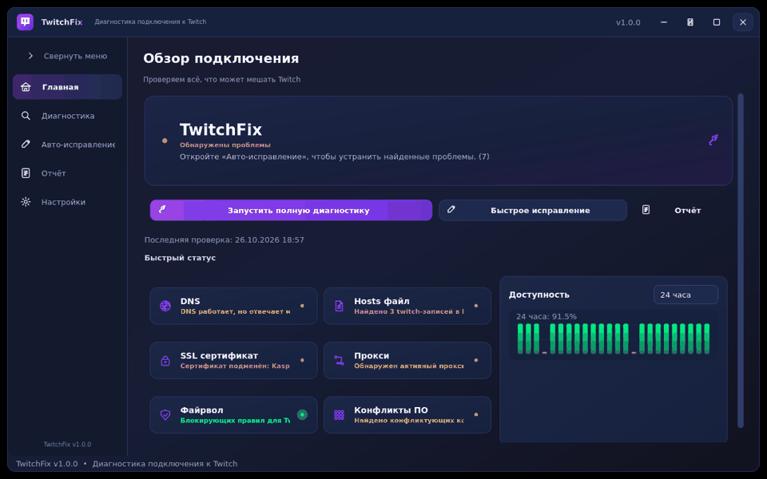
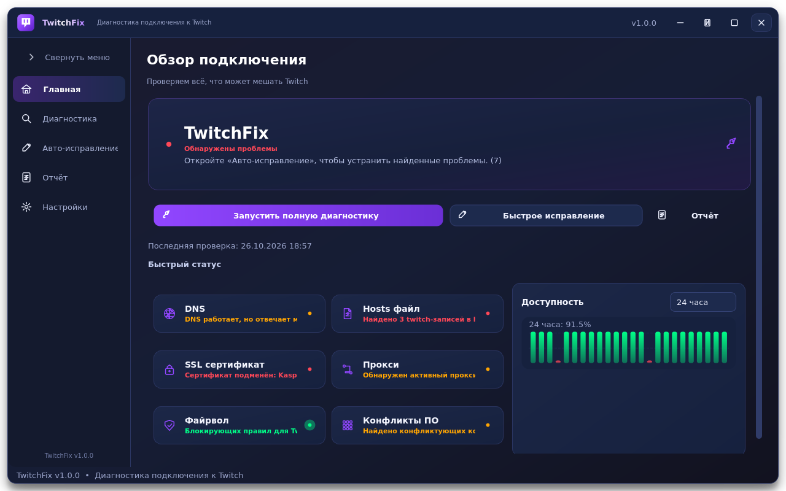
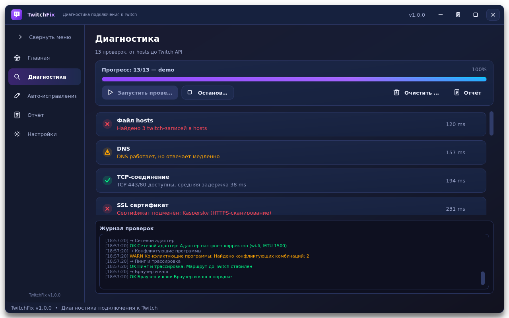
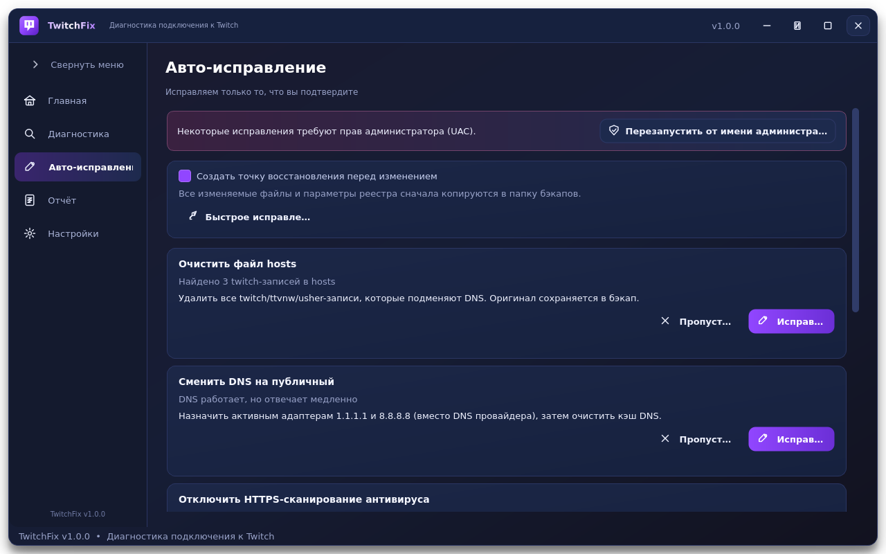
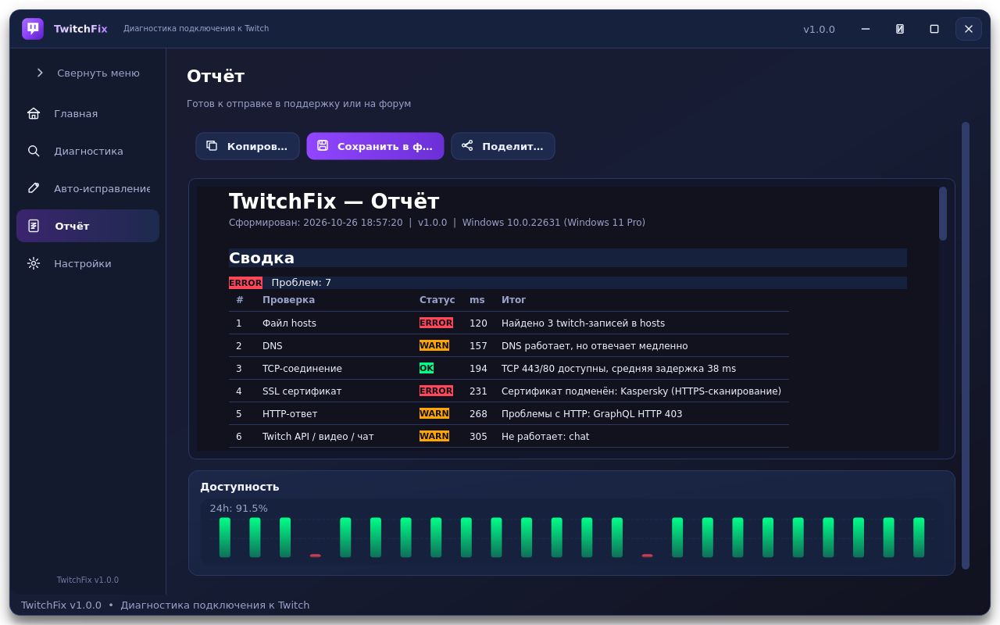
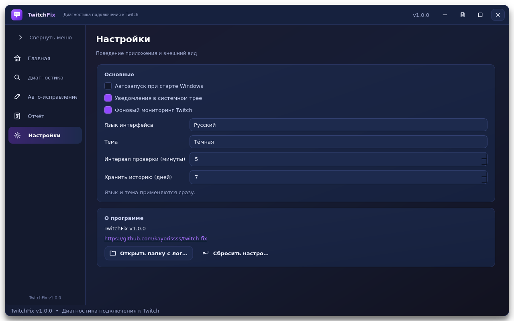
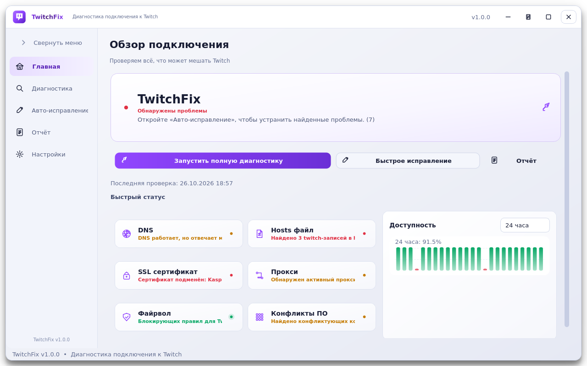
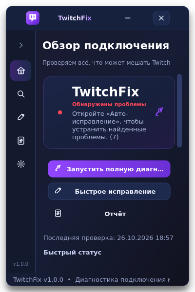

<div align="center">


**Десктопная утилита для диагностики и исправления проблем с подключением к Twitch.tv**
**A desktop utility that diagnoses and repairs Twitch connectivity problems**

[](https://github.com/kayorissss/twitch-fix/releases)
[](https://www.python.org/)
[](LICENSE)
[](https://www.microsoft.com/windows)
[](https://github.com/kayorissss/twitch-fix/actions/workflows/build.yml)
[](https://github.com/kayorissss/twitch-fix/releases)

[🇷🇺 Русский](#-русский) · [🇬🇧 English](#-english) · [📦 Releases](https://github.com/kayorissss/twitch-fix/releases) · [🐛 Issues](https://github.com/kayorissss/twitch-fix/issues)

</div>

---

## 🇷🇺 Русский

### Что это?

**TwitchFix** — приложение для Windows 10/11, которое за один клик проверяет **13 подсистем**, влияющих на доступ к Twitch, показывает понятный отчёт и предлагает **9 исправлений**.
Интерфейс — тёмный минималистичный UI в духе NVIDIA App / Discord / Spotify: frameless-окно, градиенты, анимации, системный трей, русский и английский языки.

> Twitch не открывается, крутится загрузка, не работает чат или видео, `gql.twitch.tv` отдаёт ошибку? Чаще всего виноваты `hosts`, DNS, прокси, HTTPS-сканирование антивируса или DPI-обход. TwitchFix находит конкретную причину.

<p align="center">
  
</p>

### Возможности

| | |
|---|---|
| 🔍 **13 проверок** | hosts, DNS, TCP, SSL, HTTP, Twitch API/видео/чат, время, прокси, файрвол, адаптер, процессы, ping/traceroute, браузер |
| 🔧 **9 авто-исправлений** | hosts, DNS, прокси, файрвол, MTU/IPv6, время, SSL-инструкции, кэш браузера, конфликтующие процессы |
| ⚡ **Quick Fix** | flush DNS → hosts → Winsock → кэш браузера одной кнопкой |
| 🛡️ **Безопасность** | все изменения — только после подтверждения и с бэкапом; опциональная точка восстановления Windows |
| 🔔 **Мониторинг** | проверка каждые 5 минут в системном трее, уведомления о потере/восстановлении связи |
| 📈 **История** | график доступности за 24 часа и 7 дней |
| 📋 **Отчёт** | Markdown / HTML / TXT, копирование и короткая версия для поддержки или форума |
| 🎨 **UI** | кастомный title bar, sidebar 60/200 px, fade/slide-переходы, тёмная и светлая темы, компактное окно 400×600, F11 |
| 🌐 **Двуязычность** | русский по умолчанию, английский переключается мгновенно |

### Скриншоты

<p align="center">
  
  
</p>
<p align="center">
  
  
</p>
<p align="center">
  
  
</p>
<p align="center">
  
</p>

### Установка (готовый .exe)

1. Скачайте **TwitchFix.exe** из [Releases](https://github.com/kayorissss/twitch-fix/releases) (Windows 10/11, x64).
2. Запустите. Установка не требуется — это portable one-file сборка.
3. Нажмите **«Запустить полную диагностику»**.
4. Для исправлений, меняющих систему, понадобятся права администратора: нажмите «Перезапустить от имени администратора» и подтвердите **UAC**.

> Диагностика работает без прав администратора. UAC нужен только для изменений (hosts, DNS, Winsock, реестр прокси, файрвол, MTU).

Данные приложения: `%LOCALAPPDATA%\TwitchFix\` — `logs\`, `backups\`, `data\history.jsonl`, `config\settings.ini`.

### Как пользоваться

1. **Главная** — общий статус, 6 быстрых карточек, график доступности, кнопки диагностики и Quick Fix.
2. **Диагностика** — прогресс, 13 карточек с раскрываемыми деталями и цветным логом.
3. **Авто-исправление** — список найденных проблем, что именно будет сделано, «Исправить» / «Пропустить» / «Исправить всё», чекбокс точки восстановления.
4. **Отчёт** — «Копировать», «Сохранить в файл», «Поделиться» (короткая версия для форума).
5. **Настройки** — автозапуск, язык, тема, уведомления, интервал мониторинга, срок хранения истории.

Горячие клавиши: **F11** — полноэкранный режим, **Esc** — выход из него. Кнопка в title bar переключает компактное окно 400×600.

### Что именно проверяется

| # | Проверка | Что делает | Исправление |
|---:|---|---|---|
| 1 | hosts | Все строки с `twitch`, `ttvnw`, `usher`, `video-weaver`, `jtvnw`, `live-video`, `cloudfront` + определение источника (zapret, AdGuard, GoodbyeDPI …) | Удаление строк с бэкапом |
| 2 | DNS | 15 доменов, поиск подмены (127.x, 0.0.0.0, LAN, CGNAT), сравнение с Google DNS 8.8.8.8, замер отклика | 1.1.1.1 / 8.8.8.8 + flush DNS |
| 3 | TCP | Порты 443 и 80 для ключевых доменов, latency handshake | Подсказка по файрволу |
| 4 | SSL | Издатель, срок действия, подмена антивирусом (Kaspersky, ESET, Avast, BitDefender, Norton, McAfee, AVG, Dr.Web) | Инструкция по отключению HTTPS-сканирования |
| 5 | HTTP | GET twitch.tv с реальным User-Agent, поиск провайдерской заглушки, POST к gql.twitch.tv | Отключение прокси при заглушке |
| 6 | Время | Сверка с NTP pool.ntp.org, порог 5 минут | w32tm /resync |
| 7 | Прокси | Переменные окружения, реестр HKCU, WinHTTP, PAC-файлы | Отключение прокси/PAC |
| 8 | Файрвол | Блокирующие исходящие правила для Twitch и браузеров | Разрешающее правило + отключение блокирующих |
| 9 | Адаптер | IP, шлюз, DNS, MTU (рекомендуется 1400 для раздачи), IPv6, тип подключения | MTU, отключение IPv6 |
| 10 | Процессы | Антивирусы, VPN, DPI-обход, прокси/MITM, блокировщики; конфликтующие комбинации | Мягкое закрытие DPI/VPN/прокси-процессов |
| 11 | Ping/трассировка | ICMP до Twitch и CDN, traceroute с точкой обрыва | — |
| 12 | Браузер | Установленные браузеры, расширения, размер кэша | Очистка кэша + flush DNS |
| 13 | Twitch API | Сайт, GraphQL, видео CDN (`usher.ttvnw.net`), WebSocket-чат — определяет, что именно не работает | Рекомендации по DNS/прокси |

### Безопасность и приватность

- Никакой телеметрии, рекламы, скрытых сетевых запросов «домой»: только проверки доменов Twitch, NTP и публичного DNS.
- Все изменяемые файлы и значения реестра копируются в `backups/<дата>/` вместе с `manifest.json`; при необходимости можно восстановить вручную.
- Точка восстановления Windows создаётся опционально (галочка на экране авто-исправления).
- Антивирусы никогда не завершаются принудительно; для SSL-подмены показывается пошаговая инструкция.
- Отчёт не содержит паролей, токенов, логинов прокси (они маскируются) и имён пользователей Windows.
- Проект не affiliated с Twitch Interactive, Inc.

### Сборка из исходников

```bash
git clone https://github.com/kayorissss/twitch-fix.git
cd twitch-fix
python -m venv .venv
.venv\Scripts\activate          # Windows  (Linux/macOS: source .venv/bin/activate)
pip install -r requirements.txt
python src/main.py              # запуск из исходников
```

Сборка `.exe` одной командой:

```bat
build.bat
```

…или вручную:

```bash
pip install ".[build]"          # PyInstaller + Pillow
python build.py                 # результат: dist/TwitchFix.exe
python build.py --debug         # сборка с консолью для отладки
python build.py --upx-dir C:\upx   # дополнительное сжатие UPX
```

Тесты и генерация ресурсов:

```bash
pip install pytest
python -m pytest -q            # 44 теста, платформо-независимые
python scripts/generate_assets.py   # иконки, баннер, реальные скриншоты UI
```

### Структура проекта

```
TwitchFix/
├── README.md · LICENSE · CONTRIBUTING.md · CHANGELOG.md
├── requirements.txt · setup.py · build.py · build.bat
├── .github/workflows/build.yml        # тесты + автосборка релиза
├── assets/                            # icon.ico/png, logo.svg, banner, screenshots, demo.gif
├── scripts/generate_assets.py         # генерация всех ресурсов
├── src/
│   ├── main.py · app.py               # точка входа и QApplication
│   ├── ui/                            # главное окно, title bar, sidebar, 5 страниц, виджеты, QSS
│   ├── core/
│   │   ├── diagnostics/               # 13 модулей проверок + base_check.py
│   │   ├── fixes/                     # 9 исправлений + quick_fix.py
│   │   ├── engine.py                  # QThreadPool: диагностика и исправления
│   │   ├── monitor.py · history.py · report_generator.py
│   ├── config/                        # константы, настройки, локализация RU/EN
│   └── utils/                         # admin/UAC, бэкапы, логи, системная информация
└── tests/                             # pytest: hosts, dns, движки, отчёты, история …
```

### FAQ

**Насколько велик .exe?** PyQt6 onefile обычно даёт 50–70 МБ. `build.py` уже исключает неиспользуемые Qt-модули; чтобы приблизиться к 40 МБ, укажите `--upx-dir` (UPX сжимает дополнительно) и используйте Python 3.11 x64. Это ограничение Qt, а не кода приложения.

**Антивирус ругается на .exe.** PyInstaller-сборки часто попадают под эвристики. Соберите из исходников сами или добавьте исключение; исходный код полностью открыт.

**Почему Quick Fix просит перезагрузку?** `netsh winsock reset` применяется после перезапуска сети/ОС.

**Смена DNS не помогла / сломала сеть.** Все предыдущие значения записаны в `backups/<сессия>/manifest.json`; верните их через «Панель управления → Сеть» или восстановите из точки восстановления.

**Можно ли запустить на Linux/macOS?** Ядро проверок кроссплатформенно и покрыто тестами, но исправления (hosts/DNS/файрвол/рейстр) и target-сборка рассчитаны на Windows 10/11. На Linux приложение запустится из исходников, часть проверок будет помечена `SKIPPED`.

**Twitch снова поменял публичный Client-ID.** Диагностический GraphQL-запрос может вернуть 401/403 — приложение пометит это как предупреждение и покажет в логе; обновите `TWITCH_WEB_CLIENT_ID` в `src/config/constants.py`.

**Где логи?** «Настройки → Открыть папку с логами» или `%LOCALAPPDATA%\TwitchFix\logs\twitchfix.log`.

**Как добавить свою проверку?** Создайте наследника `BaseCheck` в `src/core/diagnostics/`, зарегистрируйте его в `CHECK_CLASSES`, при необходимости добавьте `BaseFix` в `src/core/fixes/` и тест в `tests/`.

### Contributing

PR приветствуются: см. [CONTRIBUTING.md](CONTRIBUTING.md). Перед отправкой: `python -m pytest -q`, `python -m compileall -q src`, понятный коммит и описание проблемы/решения.

### Лицензия

[MIT](LICENSE) © 2026 TwitchFix contributors.

---

## 🇬🇧 English

### What is it?

**TwitchFix** is a Windows 10/11 desktop app that runs **13 diagnostics** for Twitch connectivity issues, explains the root cause, and offers **9 one-click fixes**. Dark minimalist UI (NVIDIA App / Discord / Spotify inspired), frameless window, animations, tray monitoring, RU/EN localization.

### Highlights

- **Checks:** hosts, DNS (with Google DNS comparison), TCP 443/80, SSL/MITM detection (Kaspersky, ESET, Avast, BitDefender, Norton, McAfee, AVG, Dr.Web), HTTP + GraphQL, NTP time skew, proxy/PAC, Windows Firewall, MTU/IPv6, conflicting software, ping/traceroute, browser cache, and a split Twitch API / video / chat probe.
- **Fixes:** hosts cleanup, public DNS, proxy disabling, firewall allow rule, MTU/IPv6, time sync, antivirus HTTPS-scanning guide, browser cache, conflicting process termination (never touches antivirus).
- **Quick Fix:** flush DNS → hosts → Winsock → browser cache.
- **Safety:** every change requires your confirmation, backups everything to `%LOCALAPPDATA%\TwitchFix\backups`, optional Windows restore point, UAC elevation only when needed, no telemetry, credentials masked in reports.
- **Extras:** background monitoring every 5 minutes with tray notifications, 24h/7d availability history, Markdown/HTML/TXT report + share text, light theme, compact 400×600 mode, F11 fullscreen.

### Install

Download **TwitchFix.exe** from [Releases](https://github.com/kayorissss/twitch-fix/releases) and run it — no installation required. Click **Run full diagnostics**; for system changes restart as administrator via the UAC button.

### Build from source

```bash
git clone https://github.com/kayorissss/twitch-fix.git
cd twitch-fix
python -m venv .venv && .venv/Scripts/activate   # Windows
pip install -r requirements.txt
python src/main.py

# one-file exe
pip install ".[build]"
python build.py            # dist/TwitchFix.exe
python -m pytest -q        # 44 tests
```

`build.bat` does the same on Windows in one command. GitHub Actions runs the test matrix on Python 3.11/3.12 and builds/releases the Windows executable on `v*` tags.

### FAQ (EN)

**EXE size:** PyQt6 one-file builds are typically 50–70 MB; `build.py` excludes unused Qt modules and supports `--upx-dir` for UPX compression to get closer to ~40 MB.
**Antivirus false positive:** common for PyInstaller binaries; build from source or whitelist the file.
**Non-Windows:** the diagnostic core is cross-platform and tested on Linux; Windows-specific checks/fixes are skipped there.
**Logs/backups:** `%LOCALAPPDATA%\TwitchFix\logs\` and `...\backups\`.

### Contributing & License

See [CONTRIBUTING.md](CONTRIBUTING.md). Licensed under [MIT](LICENSE). Not affiliated with Twitch Interactive, Inc.
